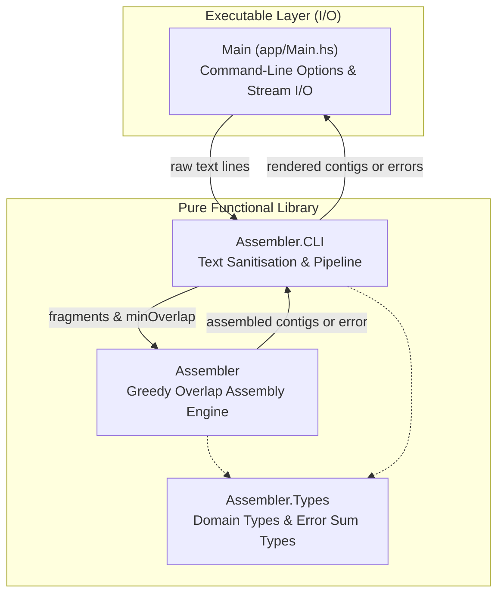
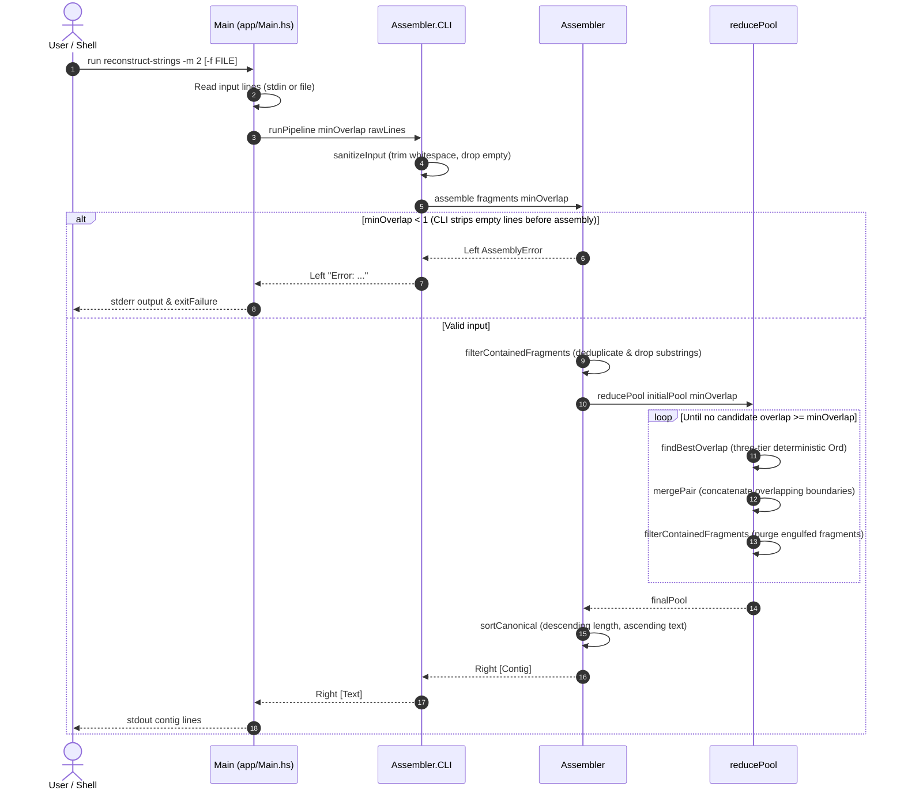

# Reconstruct Strings

This project is a learning exercise intended to understand how to assemble
strings from overlapping fragments, using the Overlap-Layout-Consensus (OLC)
paradigm.

It is a pure, total Haskell implementation of a greedy overlap sequence
assembler, designed to reconstruct contiguous sequences (*contigs*) from short
overlapping string fragments or DNA sequencing reads. An [interactive web
implementation][web-app] is also available to visualise the algorithm.

[![How Algorithms Rebuild Shattered DNA][banner-image]][video-url]

## Overview

Reconstructing a DNA sequence from short fragments – a foundational step in
*de novo* genome assembly – can be approximated through the
Overlap-Layout-Consensus (OLC) paradigm.

This project implements a deterministic, pure functional greedy overlap
reduction algorithm that:

- Validates input parameters totally without partial runtime exceptions.
- Deduplicates identical fragments to a single representative sequence.
- Eliminates fragments contained as proper substrings within longer fragments.
- Merges the candidate pair with the longest valid suffix-prefix match.
- Resolves ties deterministically using a strict three-tier total order.
- Dynamically purges fragments engulfed by newly formed composite contigs.
- Terminates when no pairwise overlap satisfies the minimum threshold.
- Sorts final contigs into a canonical, permutation-invariant order.

## Architecture

The system enforces a clean separation of concerns between effectful stream
I/O and pure functional sequence reconstruction.

### Component Diagram

The following diagram illustrates the structural decoupling between the
executable layer, pure CLI pipeline, core greedy assembly engine, and domain
models:



### Sequence Diagram

The assembly workflow proceeds through input sanitisation, precondition
validation, initial containment filtering, recursive greedy reduction, and
canonical contig ordering:



## Quick Start

### Prerequisites

- [GHC][ghc-url] 9.6.7 (as used by CI; the Cabal file requires
  `base ^>=4.18.3`)
- [Cabal][cabal-url] (>= 3.0)
- Optional: `make` for task automation, plus `stylish-haskell`, `cabal-fmt`,
  `hlint` and `hasktags` for `make format` and `make check`

### Build and Test

```bash
# Build library and executable
cabal build
# Or: make build

# Run unit and property tests
cabal test
# Or: make test
```

### Running the Assembler

Reconstruct a sequence from fragments supplied via standard input:

```bash
printf "ATGGC\nGGCGT\nCGTGCA\n" | cabal run reconstruct-strings -- -m 2
```

Output:

```text
ATGGCGTGCA
```

## Usage

### Command-Line Options

- `-m`, `--min-overlap INT`: Minimum overlap threshold (default: `2`).
- `-f`, `--file FILE`: Path to input file (one fragment per line). If omitted,
  fragments are read from standard input (`stdin`).

### Generating Synthetic Fragments

Generate synthetic fragments (strands) from a text file using the included shell
script:

```bash
./scripts/make-strands.sh -i sample.txt -m 10 -M 50 -n 100 > fragments.txt
```

### End-to-End Simulation Pipeline

Verify assembly accuracy against a known reference sequence:

1. Create a synthetic reference sequence:

   ```bash
   cat /dev/urandom | tr -dc 'ATGC' | fold -w 64 | head -n 10 > sample.txt
   ```

2. Fragment the reference sequence into overlapping strands:

   ```bash
   ./scripts/make-strands.sh -i sample.txt -m 8 -M 60 -n 1000 > strands.txt
   ```

3. Reassemble the fragmented strands:

   ```bash
   cabal run reconstruct-strings -- -m 4 -f strands.txt 2>/dev/null \
      | fold -w 64 > reconstructed.txt
   ```

4. Compare reference sequence with assembled output:

   ```bash
   sdiff -s sample.txt reconstructed.txt
   ```

## Interactive Web Implementation

An interactive web implementation (using TypeScript) is available in the
[reconstruct-strings-web][web-repo] repository.

It publishes an interactive implementation of the Overlap-Layout-Consensus (OLC)
paradigm, which can be run online at [GitHub Pages][web-app].

## Documentation Index

Detailed documentation is organised in [`docs/`][docs-dir]:

- [Domain Glossary][glossary]: Definitions of domain terminology including
  fragments, contigs, overlaps, and coverage.
- [Parameter Heuristics Guide][heuristics]: Mathematical collision
  probabilities, overlap lower/upper bounds, and parameter tuning guidelines.
- [Biological Background][dna-doc]: Context on *de novo* DNA sequence assembly
  comparing OLC and de Bruijn graph paradigms.
- [Assembler Specification (REQ-001)][req-001]: Formal functional requirements,
  pipeline sequence diagram, and architectural decision records.
- [Strand Generator Specification (REQ-002)][req-002]: Functional requirements
  and design records for the synthetic fragment generator.
- [Code Simplification Specification (REQ-003)][req-003]: Review-driven
  simplifications of the assembler, CLI, and build configuration.
- [Animation Guide][animation-doc]: Visual storyboard for step-by-step
  algorithmic animation and diagram generation.

## Build and Development

Development automation targets are defined in the [`Makefile`][makefile]:

- `make` (or `make default`): Formats, lints, builds, and runs the test suite.
- `make all`: Runs the full pipeline including documentation and sample runs.
- `make help`: Lists available targets.
- `make format`: Formats source files (`stylish-haskell`) and Cabal file
  (`cabal-fmt`).
- `make check`: Runs static analysis (`make tags` and `make lint`).
- `make tags`: Generates ctags for Haskell sources (`hasktags`).
- `make lint`: Runs `hlint` and `cabal check`.
- `make build`: Compiles the library and executable.
- `make test`: Builds and executes unit tests and QuickCheck property tests.
- `make doc`: Generates Haddock documentation with hyperlinked source code.
- `make exec`: Executes sample sequence assembly runs.
- `make ghci`: Opens an interactive GHCi session via `cabal repl`.
- `make clean`: Removes build artifacts and tags.
- `make cleanall`: Also removes the `dist-newstyle` build directory.
- `make setup`: Initialises Cabal user config and updates package dependencies.

## Project Structure

- [`reconstruct-strings.cabal`][cabal-file]: Package configuration declaring
  dependencies, compiler flags, and build components.
- [`Makefile`][makefile]: Development automation targets.
- [`src/Assembler.hs`][src-assembler]: Public API and core functional greedy
  reduction engine.
- [`src/Assembler/CLI.hs`][src-assembler-cli]: Pure transformation pipeline,
  text sanitisation, and CLI error formatting.
- [`src/Assembler/Types.hs`][src-assembler-types]: Domain newtypes (`Fragment`,
  `Contig`), the `OverlapLength` alias, and the `AssemblyError` sum type.
- [`app/Main.hs`][app-main]: Executable entry point with command-line option
  parsing and stream I/O.
- [`test/Spec.hs`][test-spec]: Test driver discovered by `hspec-discover`.
- [`test/AssemblerSpec.hs`][test-assembler-spec]: Hspec unit tests and
  QuickCheck property tests.
- [`scripts/make-strands.sh`][make-strands]: Shell utility for generating random
  synthetic fragments.
- [`docs/`][docs-dir]: Project specifications, guides, and background theory.
- [`.github/workflows/haskell.yml`][github-actions]: Continuous integration
  workflow.

## Continuous Integration

GitHub Actions workflow configuration is defined in
[`.github/workflows/haskell.yml`][github-actions], which automatically validates
Cabal metadata, builds the project, runs tests, and executes sample
reconstructions on pushes and pull requests.

## License

This project is licensed under the BSD-3-Clause license. See
[`LICENSE`][license] for details.

[animation-doc]: docs/animation.md
[app-main]: app/Main.hs
[banner-image]: docs/how-algorithms-rebuild-shattered-dna.png
[cabal-file]: reconstruct-strings.cabal
[cabal-url]: https://www.haskell.org/cabal/
[dna-doc]: docs/reconstructing-complete-dna-strand-from-short-fragments.md
[docs-dir]: docs/
[ghc-url]: https://www.haskell.org/ghc/
[github-actions]: .github/workflows/haskell.yml
[glossary]: docs/GLOSSARY.md
[heuristics]: docs/heuristics.md
[license]: LICENSE
[make-strands]: scripts/make-strands.sh
[makefile]: Makefile
[req-001]: docs/REQ-001-functional-greedy-overlap-assembler.md
[req-002]: docs/REQ-002-shell-script-to-make-strands.md
[req-003]: docs/REQ-003-code-simplification.md
[src-assembler-cli]: src/Assembler/CLI.hs
[src-assembler-types]: src/Assembler/Types.hs
[src-assembler]: src/Assembler.hs
[test-assembler-spec]: test/AssemblerSpec.hs
[test-spec]: test/Spec.hs
[video-url]: https://youtu.be/z2dpAw3IzmE?si=hfSzDUGu-2-OcCqB
[web-app]: https://frankhjung.github.io/typescript-reconstruct-strings-web/
[web-repo]: https://github.com/frankhjung/typescript-reconstruct-strings-web
